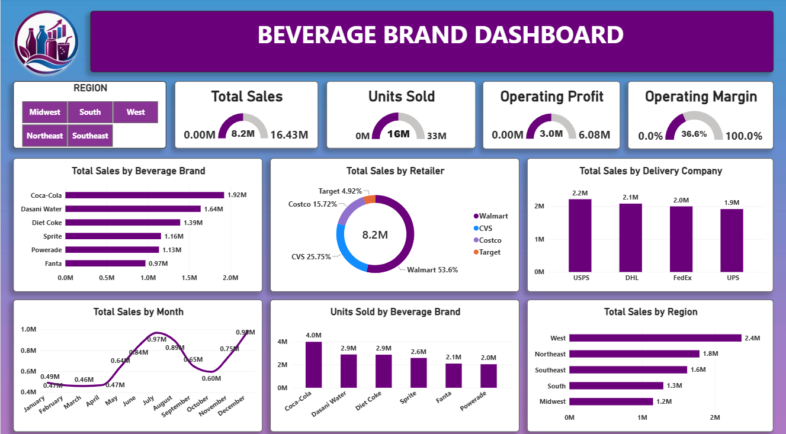

# 🥤 Beverage Brand Sales Dashboard 📊

## 📖 Project Overview

The **Beverage Brand Sales Dashboard** is an interactive **Power BI** project designed to analyze beverage sales performance across different brands, retailers, delivery companies, and regions. It provides a comprehensive overview of total sales, units sold, operating profit, operating margin, and monthly sales trends using interactive visualizations and regional slicers. The dashboard helps identify top-performing brands, evaluate business performance, and discover opportunities for sales growth.

---

## 📸 Dashboard Preview

---

## 🎯 Project Objectives

- 💰 Analyze total sales and operating profit.
- 📦 Track units sold across beverage brands.
- 🥤 Identify the best-performing beverage brands.
- 🛒 Compare sales contributions across retailers.
- 🚚 Analyze sales associated with delivery companies.
- 📅 Understand monthly sales trends.
- 🌎 Evaluate sales performance across different regions.
- 📈 Monitor operating margin and business profitability.

---

## 💎 Key Performance Indicators (KPIs)

| KPI | Value |
|---|---:|
| 💰 Total Sales | 8.2M |
| 📦 Units Sold | 16M |
| 💵 Operating Profit | 3.0M |
| 📈 Operating Margin | 36.6% |

---

## 📊 Dashboard Visualizations

### 🥤 1. Total Sales by Beverage Brand

Compares the sales performance of different beverage brands.

- 🥇 Coca-Cola: 1.92M
- 🥈 Dasani Water: 1.64M
- 🥉 Diet Coke: 1.39M
- 🥤 Sprite: 1.16M
- ⚡ Powerade: 1.13M
- 🍊 Fanta: 0.97M

### 🛒 2. Total Sales by Retailer

Shows the percentage contribution of different retailers to total sales.

- 🟣 Walmart: 53.6%
- 🔵 CVS: 25.75%
- 🟪 Costco: 15.72%
- 🟠 Target: 4.92%

### 🚚 3. Total Sales by Delivery Company

Compares sales across four delivery companies.

- 📦 USPS: 2.2M
- 🚛 DHL: 2.1M
- 🚚 FedEx: 2.0M
- 📬 UPS: 1.9M

### 📅 4. Total Sales by Month

Displays monthly sales trends throughout the year.

- 📈 January: 0.49M
- 📉 March: 0.46M
- 🚀 July: 0.97M
- 📊 October: 0.60M
- 🏆 December: 0.98M

### 📦 5. Units Sold by Beverage Brand

Analyzes the quantity of products sold by each beverage brand.

- 🥤 Coca-Cola: 4.0M units
- 💧 Dasani Water: 2.9M units
- 🥤 Diet Coke: 2.9M units
- 🥤 Sprite: 2.6M units
- 🍊 Fanta: 2.1M units
- ⚡ Powerade: 2.0M units

### 🌎 6. Total Sales by Region

Compares sales performance across five regions.

- 🥇 West: 2.4M
- 🥈 Northeast: 1.8M
- 🥉 Southeast: 1.6M
- 📍 South: 1.3M
- 📍 Midwest: 1.2M

---

## 🔍 Key Business Insights

- 🏆 **Top-Selling Brand:** Coca-Cola leads beverage brand sales with 1.92M.
- 🛍️ **Leading Retailer:** Walmart contributes the largest retailer share at 53.6%.
- 🌎 **Best-Performing Region:** The West leads regional sales with 2.4M.
- 📅 **Peak Sales Month:** December records the highest monthly sales at approximately 0.98M.
- 🚚 **Leading Delivery Company:** USPS has the highest displayed sales at 2.2M.
- 📦 **Highest Sales Volume:** Coca-Cola leads in units sold with 4.0M units.
- 💹 **Profitability:** The dashboard reports an operating margin of 36.6%.

---

## 🧰 Tools & Technologies

- 📊 **Microsoft Power BI** – Dashboard creation and data visualization
- 🧹 **Data Preparation** – Organizing and preparing sales data
- 📈 **Data Analysis** – Identifying trends and performance patterns
- 🎛️ **Interactive Slicers** – Filtering data by region
- 💼 **Business Intelligence** – Supporting data-driven decisions

---

## 🚀 Business Recommendations

- 🎯 Develop targeted marketing campaigns for lower-performing brands.
- 🌍 Explore opportunities to increase sales in the Midwest and South regions.
- 🛒 Maintain strong relationships with high-performing retailers.
- 📦 Optimize inventory according to monthly sales trends.
- 📈 Monitor operating profit and operating margin to maintain profitability.
- 🚚 Evaluate delivery performance to identify opportunities for distribution improvements.

---

## 🏁 Conclusion

The Beverage Brand Sales Dashboard provides a clear overview of sales performance, product demand, retailer contributions, delivery company sales, and regional trends. The analysis identifies Coca-Cola as the leading brand, Walmart as the largest retailer contributor, and the West as the top-performing region.

This project demonstrates how Microsoft Power BI can transform sales data into actionable business insights and support effective business decision-making.

---

## 💼 Skills Demonstrated

`Microsoft Power BI` `Data Analysis` `Data Visualization` `Business Intelligence` `KPI Reporting` `Sales Analysis` `Dashboard Design`

---

## 📬 Connect With Me

**👩‍💻 Prachi Sharma**

- 📧 **Gmail:** [prachi2sharma000@gmail.com](mailto:prachi2sharma000@gmail.com)
- 🐙 **GitHub:** [Prachisharmaa1](https://github.com/Prachisharmaa1/Bike-Purchase)
- 💼 **LinkedIn:** [Prachi Sharma](https://www.linkedin.com/in/prachi-sharma-11831330b/)

---

